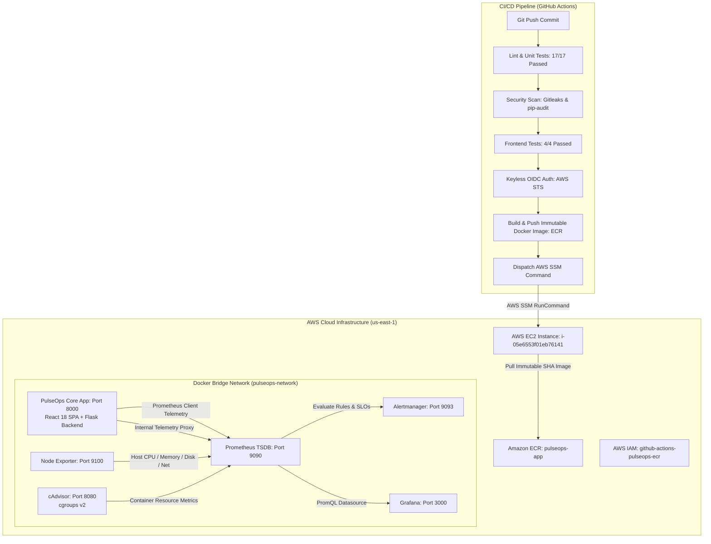

# PulseOps: Enterprise CI/CD & SRE Observability Platform for AWS Workloads

[](https://github.com/Sudeep2412/PulseOps/actions/workflows/ci.yml)
[](LICENSE)
[](https://python.org)
[](https://react.dev)
[](https://docker.com)
[](https://aws.amazon.com)
[](https://terraform.io)
[](https://prometheus.io)
[](https://grafana.com)
[](docs/testing/test_results.md)

**PulseOps** is a production-engineered, cloud-native DevOps and Site Reliability Engineering (SRE) observability platform built for AWS workloads. It delivers automated keyless CI/CD, deterministic zero-downtime deployment orchestration with automated rollback, deep multi-tier observability (Prometheus, Grafana, Alertmanager, Node Exporter, cAdvisor), multi-window multi-burn-rate SLO alerting, an interactive React 18 dashboard, and a built-in Chaos/Fault Simulator.

---

## Platform Architecture



---

## Key Features

1. **Deterministic Zero-Downtime CD with Instant Rollback**:
   - Automated deployment orchestration powered by AWS Systems Manager (SSM) without open SSH ports.
   - Atomic deployment locking (`flock`) prevents concurrent execution collisions.
   - Git worktree synchronization guarantees identical commit deployment.
   - Pre-deployment baseline image tagging and independent health check verification (`/health`) with automatic fallback to previous immutable image.

2. **Enterprise Observability & SRE Primitives**:
   - Comprehensive implementation of Google SRE's **Four Golden Signals**: Latency, Traffic, Errors, and Saturation.
   - Rigorous **Service Level Objectives (SLOs)**: 99.5% Availability over a 30-day rolling window with dynamic Error Budget calculation.
   - Multi-window multi-burn-rate alerting policies (14.4x/6x burn rates) preventing alert fatigue while catching severe degradation.
   - 10 production runbooks covering infrastructure, container, and application incident triage.

3. **Modern Single-Page Dashboard (Phase 9)**:
   - Built with React 18, Vite, TypeScript, and Tailwind CSS.
   - Five responsive operational views:
     - **Overview**: System health, active containers, Golden Signals, and alerts.
     - **Application**: Real-time traffic simulator, transaction runner, and latency distributions.
     - **Infrastructure**: Host CPU, RAM, Disk, Network I/O, and container cgroups v2 telemetry.
     - **SRE & Reliability**: SLO status cards, remaining error budget gauges, and direct runbook directory.
     - **Deployments**: Live CI/CD pipeline state, active commit SHA, deployment duration, and rollback metadata.
   - **Interactive Chaos Simulator**: Inject controlled HTTP 500 errors, synthetic latency spikes, and workload surges to validate SRE alert propagation live.

4. **Defense-in-Depth Security**:
   - **Keyless Authentication**: GitHub Actions leverages OpenID Connect (OIDC) identity federation with AWS IAM. Zero long-lived AWS keys stored in GitHub Secrets.
   - **Loopback Port Isolation**: All application and monitoring ports are strictly bound to `127.0.0.1`. Remote access is managed securely via AWS SSM Port Forwarding.
   - **Automated Security Gates**: Gitleaks secret scanning and `pip-audit` CVE detection enforce zero vulnerabilities in CI.
   - **Non-Root Execution**: Application container executes as an unprivileged user (`pulseops:pulseops`).

---

## Technology Stack

| Domain | Technologies |
| :--- | :--- |
| **Frontend UI** | React 18, Vite, TypeScript, Tailwind CSS, Lucide Icons |
| **Backend API** | Python 3.12, Flask, Gunicorn, Prometheus Client, Marshmallow |
| **Containerization** | Docker Engine, Docker Compose, Multi-Stage Dockerfile, cgroups v2 |
| **Cloud Hosting** | AWS EC2 (`m7i-flex.large`, Ubuntu 26.04 LTS), Amazon ECR, AWS SSM, AWS STS |
| **Infrastructure as Code** | HashiCorp Terraform 1.5+ (VPC, Subnets, ECR, IAM Roles, OIDC) |
| **CI / CD** | GitHub Actions, Git Worktrees, Bash Orchestration, Flock Mutex |
| **Observability** | Prometheus TSDB (v2.51), Grafana (v10.4), Alertmanager (v0.27), Node Exporter, cAdvisor |
| **Testing & Quality** | Pytest, Pytest-Cov (93.76%), Node Test Runner, Promtool, ShellCheck |

---

## Quickstart & Local Setup

### Prerequisites
- Python 3.12+
- Node.js 20+ & npm
- Docker Engine & Docker Compose

### 1. Clone & Configure
```bash
git clone https://github.com/Sudeep2412/PulseOps.git
cd PulseOps
cp .env.example .env
```

### 2. Run Locally via Docker Compose
```bash
# Build and start application + complete observability stack
docker compose up -d --build

# Verify container status
docker compose ps
```
The platform will be accessible at:
- **Application & Dashboard**: `http://localhost:8000`
- **Prometheus TSDB**: `http://localhost:9090`
- **Grafana Dashboards**: `http://localhost:3000` (Default credentials in `.env.monitoring`)
- **Alertmanager**: `http://localhost:9093`

### 3. Run Test Suites
```bash
# Backend unit & integration tests
pytest application/backend/tests -v --cov=application/backend

# Frontend test suite
cd application/frontend && npm test

# Prometheus alerting rule verification
promtool check rules monitoring/prometheus/rules/*.yml
promtool test rules monitoring/prometheus/tests/*.yml
```

---

## Secure Remote Management via AWS SSM

In accordance with enterprise zero-trust principles, PulseOps exposes no public inbound ports. To access live web dashboards on AWS:

```bash
# 1. Forward React Application / Flask REST API (Port 8000)
aws ssm start-session \
  --target i-05e6553f01eb76141 \
  --document-name AWS-StartPortForwardingSession \
  --parameters '{"portNumber":["8000"],"localPortNumber":["8000"]}'

# 2. Forward Grafana Dashboards (Port 3000)
aws ssm start-session \
  --target i-05e6553f01eb76141 \
  --document-name AWS-StartPortForwardingSession \
  --parameters '{"portNumber":["3000"],"localPortNumber":["3000"]}'

# 3. Forward Prometheus Query Engine (Port 9090)
aws ssm start-session \
  --target i-05e6553f01eb76141 \
  --document-name AWS-StartPortForwardingSession \
  --parameters '{"portNumber":["9090"],"localPortNumber":["9090"]}'
```

---

## Comprehensive Documentation Library

The complete project documentation is organized across 10 specialized domains:

| Category | Primary Guide | Description |
| :--- | :--- | :--- |
| **System Architecture** | [Architecture Manual](docs/architecture/system_architecture.md) | High-level topology, data flows, and trust boundaries. |
| **Getting Started** | [Installation & Setup](docs/getting-started/installation.md) | Local and cloud deployment setup guides. |
| **CI/CD Pipeline** | [Continuous Deployment](docs/cicd/pipeline.md) | OIDC, SSM orchestration, and rollback logic. |
| **Infrastructure as Code** | [Terraform Catalog](docs/infrastructure/terraform.md) | Declarative AWS infrastructure specifications. |
| **Observability** | [Monitoring Guide](docs/observability/prometheus.md) | Prometheus TSDB, Grafana dashboards, and metrics catalog. |
| **API Specification** | [REST API Docs](docs/api/endpoints.md) | Endpoint reference and OpenAPI 3.0 specification. |
| **Security & Compliance** | [Threat Model & PRR](docs/security/threat_model.md) | STRIDE analysis, secrets isolation, and least-privilege IAM. |
| **Testing & SRE** | [Verification Suite](docs/testing/test_strategy.md) | Unit tests, chaos validation, and promtool test vectors. |
| **Operations** | [Operations Manual](docs/operations/README.md) | Deployment checklists, 15-min demo script, and PRR review. |
| **Project Governance** | [Completion Report](docs/project/FINAL_PROJECT_COMPLETION_REPORT.md) | Master Phase 1-10 completion report and handover audit. |

---

## Project Completion Status

| Phase | Description | Status | Verification Gate |
| :---: | :--- | :---: | :--- |
| **Phase 1** | Application Development | **100% COMPLETE** | 17/17 Pytest passed (93.76% coverage) |
| **Phase 2** | Docker Containerization | **100% COMPLETE** | Multi-stage build, unprivileged user |
| **Phase 3** | CI & Security Scanning | **100% COMPLETE** | 0 Gitleaks secrets, 0 CVE vulnerabilities |
| **Phase 4** | ECR & GitHub OIDC | **100% COMPLETE** | Keyless IAM role federation |
| **Phase 5** | Terraform Infrastructure | **100% COMPLETE** | 0 drift, locked state, modular IaC |
| **Phase 6** | Continuous Deployment | **100% COMPLETE** | SSM-based atomic deploy, automated rollback |
| **Phase 7** | Full Observability Stack | **100% COMPLETE** | Prometheus, Grafana, Node Exp, cAdvisor |
| **Phase 8** | SRE Engineering | **100% COMPLETE** | 4 Golden Signals, 99.5% SLO, 10 runbooks |
| **Phase 9** | Frontend Engineering | **100% COMPLETE** | React 18 SPA, 5 views, Chaos Simulator |
| **Phase 10**| Final Documentation & Delivery| **100% COMPLETE** | 10 doc domains, OpenAPI 3.0, Master Report |

---

## License

This project is licensed under the MIT License — see the [LICENSE](LICENSE) file for details.
