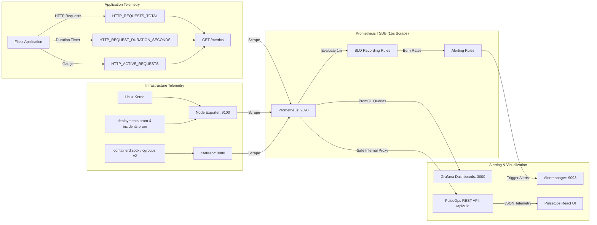

# PulseOps Data Flow Architecture

## 1. Metrics Collection & Aggregation Flow

## 2. Scraping Intervals & Retention
- **Scrape Interval**: 15 seconds across all 5 jobs (`pulseops-app`, `prometheus`, `alertmanager`, `node-exporter`, `cadvisor`).
- **Evaluation Interval**: 15 seconds for alerting rules, 1 minute for SLO recording rules.
- **TSDB Retention**: 15 days on disk volume mounted at `/home/ubuntu/PulseOps/monitoring/prometheus_data`.
