# PulseOps Deployment Architecture

## 1. Continuous Deployment Sequence
Deployments are fully automated, deterministic, and executed without storing long-lived AWS credentials.

```mermaid
sequenceDiagram
    autonumber
    actor Dev as Engineer
    participant GH as GitHub Actions
    participant OIDC as AWS IAM (OIDC)
    participant ECR as Amazon ECR
    participant SSM as AWS Systems Manager
    participant EC2 as EC2 Instance
    participant Docker as Docker Daemon

    Dev->>GH: Push commit to main (e.g. 45489f5)
    Note over GH: Job 1: Pytest Unit Tests & Coverage (>90%)
    Note over GH: Job 2: SAST (Gitleaks, pip-audit, Promtool rule tests)
    Note over GH: Job 3: Docker Multi-Stage Build & Trivy Scan
    GH->>OIDC: Request short-lived STS credentials via OIDC token
    OIDC-->>GH: Issue temporary AWS credentials (1hr)
    GH->>ECR: Push immutable image: pulseops-app:45489f5
    GH->>SSM: send-command (sync_and_deploy.sh 45489f5)
    SSM->>EC2: Execute deployment orchestrator

    rect rgb(20, 30, 50)
    Note over EC2: Concurrency Lock (/tmp/pulseops-deploy.lock)
    EC2->>EC2: Create detached Git worktree for 45489f5
    EC2->>Docker: Tag current running container as rollback-baseline
    EC2->>Docker: Verify baseline image ID matches current container
    EC2->>ECR: Pull target image (pulseops-app:45489f5)
    EC2->>Docker: docker compose up -d --no-build pulseops-app
    EC2->>Docker: Poll /health (max 6 attempts, 5s interval)
    alt Health Check Passes
        EC2->>EC2: Record success to deployments_history.jsonl
        EC2->>EC2: Emit pulseops_deployment_events_total{status="success"}
        EC2-->>SSM: Status: SUCCESS
    else Health Check Fails
        EC2->>Docker: Trigger rollback to rollback-baseline
        EC2->>EC2: Record rollback event to deployments_history.jsonl
        EC2-->>SSM: Status: FAILED (Rollback Executed)
    end
    end
    SSM-->>GH: Report deployment command outcome
```

## 2. Deployment Safety Invariants
1. **Host-Level Concurrency Control**: Managed using `flock -n 200` on `/tmp/pulseops-deploy.lock` to prevent overlapping deployments.
2. **Deterministic Worktree Isolation**: The target commit's exact deployment configuration (`docker-compose.yml`, `deploy.sh`) is checked out into `/home/ubuntu/pulseops-deployments/<COMMIT_SHA>`.
3. **Rollback Baseline Guarantee**: The existing healthy image is verified and tagged as `rollback-baseline` before pulling the new image.
4. **No-Build Guarantee**: `docker compose up -d --no-build` ensures production never attempts local image compilation.
