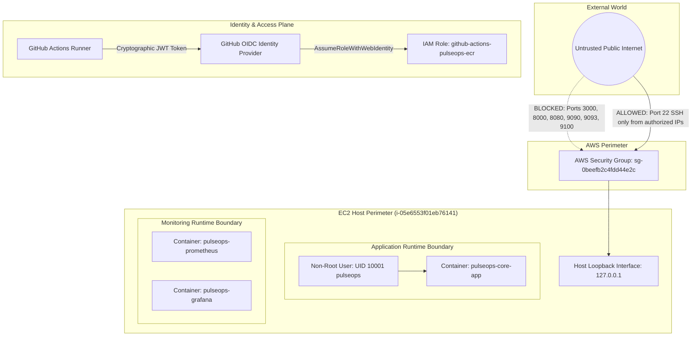

# PulseOps Security Architecture

## 1. Security Architecture & Threat Boundaries

## 2. Hardened Security Controls
1. **Zero Long-Lived Cloud Credentials**: GitHub Actions authenticates to AWS using OpenID Connect (OIDC). No static AWS Access Keys (`AKIA...`) are stored in GitHub Secrets.
2. **Loopback-Only Interface Binding**: All application and monitoring ports (3000, 8000, 8080, 9090, 9093, 9100) bind strictly to `127.0.0.1`.
3. **Container Non-Root Execution**: `deployment/Dockerfile` creates dedicated user `pulseops` (UID 10001, GID 10001). The container drops root privileges before launching Gunicorn.
4. **Supply Chain Defense**: Continuous SAST, secret auditing (Gitleaks), software composition analysis (pip-audit), and container vulnerability scanning (Trivy) run on every push.
