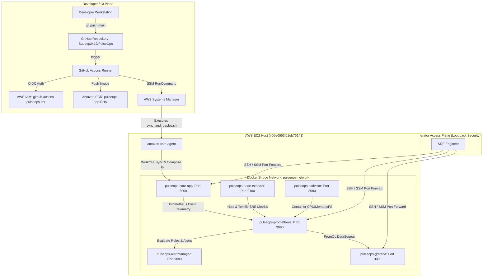

# PulseOps System Architecture

## 1. System Topology Overview
PulseOps combines an application workload, an automated continuous deployment pipeline, and a complete site reliability engineering monitoring stack into a cohesive cloud platform on AWS.

## 2. Core Subsystems

### A. Core Microservice Workload (`pulseops-core-app`)
- **Technology**: Python 3.14 (Debian slim), Flask 3.1, Gunicorn 23.0 WSGI server.
- **Role**: Serves transactional business workloads (`/api/v1/workload`), synthetic fault injection endpoints (`/api/v1/simulate-error`, `/api/v1/simulate-latency`), system health endpoints (`/health`, `/ready`), and the React-based PulseOps Dashboard UI.
- **Instrumentation**: Prom Client Prometheus registry exposing Golden Signals at `/metrics`.

### B. Observability Stack
- **Prometheus (v3.0.1)**: Scrapes telemetry every 15s; evaluates SLO recording rules and multi-window error budget burn rate alerts; persists TSDB for 15 days.
- **Node Exporter (v1.8.2)**: Collects kernel, CPU, memory, and filesystem metrics, plus textfile metrics from `/etc/node-exporter/`.
- **cAdvisor (v0.49.2)**: Integrates directly with the host containerd daemon (`/var/run/docker/containerd/containerd.sock`) to measure per-container CPU, memory working set, and I/O.
- **Alertmanager (v0.28.0)**: Manages alerts, deduplication, grouping, and notification routing.
- **Grafana (v11.4.0)**: Pre-provisioned dashboards for System Overview, Application Performance, Infrastructure Monitoring, and SRE Reliability.

### C. Network Boundary
- All monitoring and application ports are bound exclusively to `127.0.0.1`.
- AWS Security Group (`sg-0beefb2c4fdd44e2c`) restricts inbound traffic to SSH (Port 22) from authorized IP ranges.
