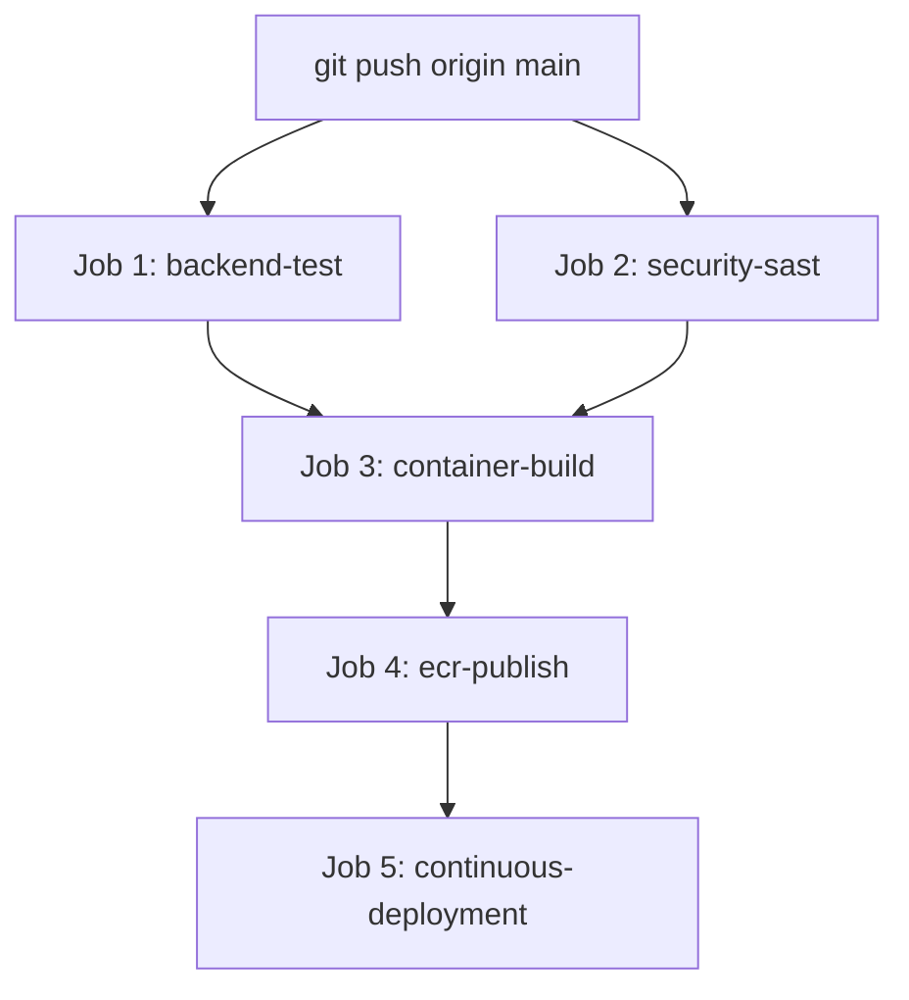

# PulseOps CI/CD Pipeline Architecture

## 1. Workflow Configuration (`.github/workflows/ci.yml`)
The pipeline runs on every push and pull request to the `main` branch.

## 2. Job Breakdown

### Job 1: `backend-test`
- **Runner**: `ubuntu-latest`
- **Steps**:
  - Checkout repository
  - Set up Python 3.12
  - Install dependencies from `application/backend/requirements.txt`
  - Execute Pytest suite with code coverage enforcement:
    `pytest application/backend/tests -v --cov=application/backend --cov-report=term-missing --cov-fail-under=80`

### Job 2: `security-sast`
- **Runner**: `ubuntu-latest`
- **Steps**:
  - Gitleaks secret detection: `gitleaks detect --source . -v`
  - Trivy filesystem vulnerability scan: `trivy fs --severity HIGH,CRITICAL .`
  - Dependency vulnerability scan: `pip-audit -r application/backend/requirements.txt`
  - Monitoring configuration validation: `docker compose config`, `bash -n`, JSON validation
  - Promtool configuration syntax: `promtool check config`
  - Promtool rules linting: `promtool check rules` across all 3 rule groups
  - Promtool unit testing: `promtool test rules` across all 6 SLI/SLO test vectors
  - Alertmanager configuration linting: `amtool check-config`

### Job 3: `container-build`
- **Dependencies**: `needs: [backend-test, security-sast]`
- **Steps**:
  - Multi-stage Docker build from `deployment/Dockerfile`
  - Verification of non-root execution (UID 10001)
  - Container image vulnerability scan using Trivy (`trivy image --severity HIGH,CRITICAL`)

### Job 4: `ecr-publish`
- **Dependencies**: `needs: [container-build]`
- **Condition**: `github.ref == 'refs/heads/main' && github.event_name == 'push'`
- **Steps**:
  - Authenticate to AWS using GitHub OIDC role `arn:aws:iam::512888109658:role/github-actions-pulseops-ecr`
  - Log in to Amazon ECR
  - Build and push immutable image tag: `512888109658.dkr.ecr.us-east-1.amazonaws.com/pulseops-app:<COMMIT_SHA>`
  - Verify image manifest in ECR registry

### Job 5: `continuous-deployment`
- **Dependencies**: `needs: [ecr-publish]`
- **Steps**:
  - Authenticate to AWS via OIDC
  - Send SSM command to EC2 instance `i-05e6553f01eb76141`
  - Execute `/home/ubuntu/PulseOps/deployment/sync_and_deploy.sh <COMMIT_SHA>`
  - Poll command status until completion
