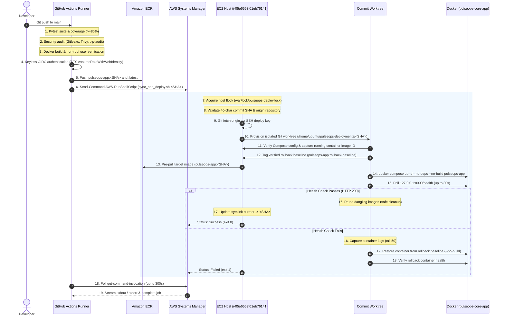

# PulseOps Continuous Deployment Architecture & Operations Guide

## 1. Overview & Architecture

PulseOps uses a secure, keyless, and immutable Continuous Deployment (CD) pipeline for AWS workloads. Deployments are triggered automatically upon merge to the `main` branch, building reproducible container images pushed to Amazon Elastic Container Registry (ECR) and deploying them to an Amazon EC2 instance orchestrated through AWS Systems Manager (SSM) Run Command.



---

## 2. Key Architectural Pillars

### A. Keyless GitHub OIDC Authentication
- **No Long-Lived Credentials**: Zero static AWS access keys or secrets exist in GitHub Secrets.
- **IAM Role**: `arn:aws:iam::512888109658:role/github-actions-pulseops-ecr`.
- **Subject Locking**: Restricted via `StringEquals` condition to repository `Sudeep2412/PulseOps` and branch `refs/heads/main`.
- **Audience**: `sts.amazonaws.com`.

### B. Deterministic Commit Synchronization via Git Worktrees
- Rather than running destructive `git pull` or `git checkout -f` inside the active repository tree (`/home/ubuntu/PulseOps`), the orchestrator (`sync_and_deploy.sh`) provisions an isolated, detached Git worktree:
  `/home/ubuntu/pulseops-deployments/<commit-sha>/`
- The deployment script executes **inside** this worktree context. It cannot overwrite itself during execution.
- Docker Compose loads the exact Compose file and environment configuration associated with that specific commit.
- Untracked files, Terraform state, and backups in `/home/ubuntu/PulseOps` are completely shielded from modification.

### C. Hardened Deployment & Automated Rollback
- **Pre-pull Isolation**: The target image is completely downloaded from ECR and verified in local cache **before** the active container is touched. If the pull fails, deployment aborts immediately without downtime.
- **Immutable Image ID Verification**: Before touching the container, `deploy.sh` inspects the running container's immutable image ID (`sha256:...`), tags the rollback baseline (`512888109658.dkr.ecr.us-east-1.amazonaws.com/pulseops-app:rollback-baseline`), and inspects the tag to verify exact ID equality.
- **No-Build Guarantee**: `docker compose up` enforces `--no-build`. It strictly uses the immutable pre-pulled image from ECR and will never execute a local host build.
- **Automated Health Verification**: Polls `http://127.0.0.1:8000/health` up to 6 times (30 seconds). If unready or unhealthy, it automatically captures diagnostic logs (`docker logs --tail 50`), rolls back to the verified baseline, verifies rollback health, and exits with code 1.

### D. Multi-Tier Concurrency Protection
1. **GitHub Actions Level**: `concurrency: group: production-deployment, cancel-in-progress: false` ensures commits queue sequentially without terminating an in-flight deployment mid-flight.
2. **Host Level**: Non-blocking file descriptor locking (`flock -n 200` on `/var/lock/pulseops-deploy.lock`) prevents multiple simultaneous deployments or synchronization runs on EC2.

---

## 3. Operational Troubleshooting Guide

| Issue / Symptom | Root Cause | Remediation |
|---|---|---|
| **SSM Command Pending / InProgress timeout** | ECR pull latency or network congestion | Polling timeout is set to 300s. Inspect command execution live via `aws ssm get-command-invocation --command-id <ID> --instance-id i-05e6553f01eb76141`. |
| **`Another deployment is already in progress`** | Stale lock or overlapping deployment | Check if a previous run is active: `ps aux \| grep deploy.sh`. If clear, remove stale lock: `rm -f /var/lock/pulseops-deploy.lock`. |
| **`Commit does not exist in repository history`** | Commit was rebased or not pushed to origin | Verify GitHub push succeeded and deploy key is functional: `sudo -u ubuntu git -C /home/ubuntu/PulseOps fetch origin`. |
| **`Rollback image verification failed`** | Docker inspect mismatch during baseline capture | Check running container image ID: `docker inspect --format '{{.Image}}' pulseops-core-app`. |
| **`docker compose up failed with --no-build`** | Target image was not found in local Docker cache | Ensure ECR authentication and pull succeeded: `aws ecr get-login-password \| docker login ...`. |

---

## 4. Controlled Manual Deployment Procedure

If AWS Systems Manager is unavailable or if a manual roll-forward/rollback is required by an authorized engineer:

```bash
# 1. SSH to the EC2 host (with authorized administrative IP)
ssh -i ~/.ssh/project.pem ubuntu@3.82.48.128

# 2. Navigate to repository base
cd /home/ubuntu/PulseOps

# 3. Synchronize and deploy the target commit SHA
./deployment/sync_and_deploy.sh <40-CHARACTER-COMMIT-SHA>

# 4. Verify local application health
curl -s http://127.0.0.1:8000/health
```