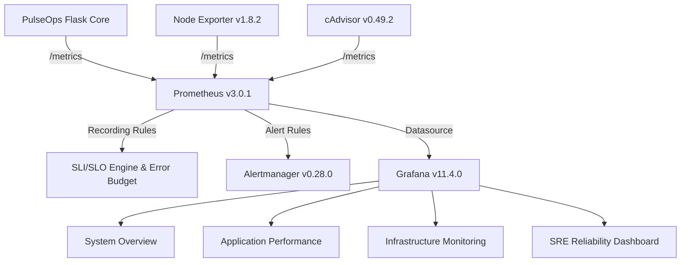

# PulseOps Site Reliability Engineering (SRE) Framework

## 1. Overview

PulseOps implements an enterprise-grade Site Reliability Engineering (SRE) capability designed to provide quantitative reliability governance, automated incident response runbooks, error budget burn rate tracking, and safe chaos/resilience testing for AWS workloads.



---

## 2. Framework Architecture

The PulseOps SRE implementation consists of five interconnected pillars:

1. **Service Level Indicators & Objectives (`slo_definitions.md`)**:
   - Availability SLO: $\ge 99.5\%$ over 30 days.
   - P95 Latency SLO: $\ge 95\%$ under $500$ ms.
   - P99 Latency SLO: $\ge 99\%$ under $1.0$ s.
   - Deployment Reliability SLO: $\ge 95\%$ without rollback.
2. **Error Budget Policy (`error_budget_policy.md`)**:
   - 0.5% allowable error quota with multi-window burn rate alerts (14.4x fast burn, 3.0x slow burn).
3. **Incident Management Framework (`incident_management.md`)**:
   - SEV-1, SEV-2, and SEV-3 operational severity criteria, response workflows, and MTTR baselines.
4. **Standard Operating Runbooks (`runbooks/`)**:
   - 11 deterministic diagnostic and remediation runbooks covering host, container, network, and telemetry failures.
5. **Reliability & Chaos Testing (`reliability_testing.md`, `reliability_results.md`)**:
   - 5 non-destructive incident simulations validating process recovery, error budget escalation, latency degradation, deployment guards, and TSDB persistence.

---

## 3. Directory Structure

```text
docs/sre/
├── README.md                     # SRE Architecture & Framework Overview
├── slo_definitions.md           # Formal SLI & SLO Mathematical Specifications
├── error_budget_policy.md       # Operational Burn Rate & Release Policy
├── incident_management.md       # Incident Lifecycle, Roles & Severity Definitions
├── reliability_testing.md       # Incident Simulation Procedures & Test Matrix
├── reliability_results.md       # Evidence & Telemetry from Live Test Scenarios
└── runbooks/                    # 11 Standard Operating Incident Runbooks
    ├── application_down.md
    ├── high_error_rate.md
    ├── high_latency.md
    ├── high_cpu.md
    ├── high_memory.md
    ├── high_disk_usage.md
    ├── container_restart.md
    ├── deployment_failure.md
    ├── rollback.md
    ├── prometheus_unavailable.md
    └── grafana_unavailable.md
```
