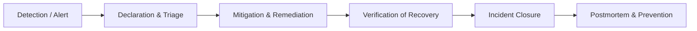

# PulseOps Incident Management Framework

## 1. Purpose

This document outlines the lightweight incident management framework designed for PulseOps AWS workloads. It provides clear, deterministic criteria for declaring, responding to, mitigating, and closing service incidents.

---

## 2. Severity Classification

| Severity Level | Criteria | Response Target | Example Triggers |
| :--- | :--- | :--- | :--- |
| **SEV-1 (Critical)** | Core application unreachable, data corruption, sustained 100% outage, critical deployment failure. | Immediate (< 5 min) | Container down, `InstanceDown` alert, HTTP 500 error storm. |
| **SEV-2 (Major)** | Elevated error rate (> 5%), P95 latency > 500ms, single collector target failure, high resource pressure. | Within 15 min | `ApplicationHighErrorRate`, `HighCPUUsage`, fast burn rate alert. |
| **SEV-3 (Minor)** | Transient anomaly, warning-level disk space, secondary telemetry delay, isolated non-critical failure. | Next business hours | `HighDiskUsage` (>85%), slow burn rate alert. |

---

## 3. Incident Lifecycle Workflow

1. **Detection**: Triggered via Alertmanager alert notification, Prometheus threshold, or synthetic health check failure.
2. **Declaration**: SRE engineer assigns severity level (SEV-1/2/3) based on criteria.
3. **Mitigation**: Execute corresponding runbook from `docs/sre/runbooks/` (e.g., container restart, traffic drain, rollback).
4. **Verification**: Confirm metrics return to healthy baseline and Prometheus alerts resolve.
5. **Closure**: Mark incident resolved and record MTTR.
6. **Postmortem**: For SEV-1 and SEV-2 incidents, document root cause and preventative action items.
